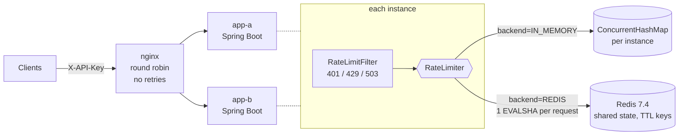

# RateGuard

[](https://github.com/Shub-ways/rateguard/actions/workflows/ci.yml)
[](https://github.com/Shub-ways/rateguard/releases/tag/v1.0.0)


**A distributed API rate limiter in Java and Spring Boot.** Four
rate-limiting algorithms behind one interface. A Redis backend lets any
number of app instances enforce **one shared quota per client**, using a
single atomic Lua script per request.

**Quick links:**
[Quick start](#quick-start-shared-quota-across-two-instances) ·
[Architecture](#architecture) ·
[Case study](docs/CASE-STUDY.md) ·
[Benchmarks](docs/BENCHMARKS.md) ·
[Configuration](docs/CONFIGURATION.md) ·
[Demo script](docs/DEMO.md)

## Verified results

| | Result | Context |
| --- | --- | --- |
| **Shared quota** | 1,000 concurrent requests from one client, quota 100: **exactly 100 accepted, 900 rejected** | 2 app instances behind nginx, shared Redis, 6 of 6 k6 trials, 0 errors ([evidence](docs/EVIDENCE.md)) |
| **Performance fix** | Redis-path throughput **+113% to +117%**, p99 latency **−27%** (108 → 79 ms) | One scenario (1 instance + Redis, 50 virtual users), old and new builds alternated in the same session on a 15 W laptop ([case study](docs/CASE-STUDY.md)) |
| **Tests** | **128 automated tests, 0 skipped** | Includes Testcontainers tests against real Redis; CI fails if any test is skipped |

Every figure links to committed raw data and its method. Numbers come from
one laptop (i5-1335U, app containers capped at 2 CPUs), so compare ratios,
not absolute values.

## Architecture



**How it works:**

- **The filter** identifies the client by API key (a missing or unknown key
  gets 401, with no IP fallback). It asks the `RateLimiter` for a decision
  and answers 200, or 429 with `Retry-After`.
- **In memory**, each key's state is updated atomically inside
  `ConcurrentHashMap.compute`. That's fast, but each instance counts on its
  own, so N instances allow N × the limit.
- **In Redis**, one Lua script per request reads, checks, updates and sets the
  expiry in a single atomic step, using Redis server time. All instances
  therefore share one exact quota.
- **If Redis is down**, the service answers 503 (`FAIL_CLOSED`, the default)
  or lets requests through (`FAIL_OPEN`). An outage is never reported as a
  429.

## Algorithms

| Algorithm | In memory | Redis | Burst behaviour |
| --- | :---: | :---: | --- |
| Fixed window | yes | yes | up to 2× limit at a window boundary |
| Sliding-window log | yes | no | none (exact) |
| Sliding-window counter | yes | no | smoothed approximation |
| Token bucket | yes | yes | up to capacity, then the refill rate |

Trade-offs, complexity and memory per client:
[ALGORITHMS.md](docs/ALGORITHMS.md). Redis design (atomicity, keys, TTL,
clock skew, failure modes): [DISTRIBUTED.md](docs/DISTRIBUTED.md).

## Quick start: shared quota across two instances

Requires Docker, JDK 25 and Maven 3.9+.

```powershell
mvn -DskipTests package                    # builds the jar the image uses
copy .env.example .env                     # then put your own random keys in .env
docker compose up --build -d               # Redis, app-a, app-b, nginx on :8080
./scripts/verify-shared-quota.ps1 -Requests 12
docker compose down
```

With a limit of 5, the 12 requests alternate between app-a and app-b, and
**exactly 5 succeed in total**. `X-RateLimit-Remaining` counts down 4 → 0
across both instances. With the in-memory backend, up to 10 would succeed.
To simulate an outage, `docker compose stop redis` gives 503s, and
`docker compose start redis` restores normal behaviour.

Running a single instance without Docker, every property, HTTP status codes
and metrics: [CONFIGURATION.md](docs/CONFIGURATION.md).

## Repository layout

| Path | Contents |
| --- | --- |
| `rateguard-core` | Algorithms, `RateLimiter`, `RateLimitResult`. Plain Java, no dependencies |
| `rateguard-redis` | Redis fixed window and token bucket (Lua). Spring Data Redis, no Spring Boot |
| `rateguard-service` | Spring Boot 4.1 HTTP service: filter, client identification, failure policy, metrics |
| `benchmarks/` | JMH and k6 harnesses, raw results and summarizer ([README](benchmarks/README.md)) |
| `compose.yaml`, `deploy/` | Docker Compose stack and nginx config |
| `docs/` | Design, evidence, benchmarks, case study, configuration, demo script |

## Tests

```powershell
mvn clean test     # 68 core + 13 redis + 47 service = 128
```

- **Core:** contract tests run against all 4 algorithms, including exact
  `Retry-After` and a linearizability replay (8 threads × 2,000 requests).
- **Service:** MockMvc tests and real-Tomcat concurrency tests.
- **With Docker (Testcontainers):**
  - the Redis limiters make the same decisions as the in-memory ones on
    3,000 random requests;
  - 2 real instances on one Redis accept exactly 100 of 1,000 concurrent
    requests;
  - Redis down at startup, paused mid-traffic, or connections killed.
- **Without Docker,** the Testcontainers tests skip themselves. CI has Docker
  and fails if anything is skipped.

## Design decisions

- **Rich result, not a boolean.** `RateLimitResult(allowed, limit,
  remaining, retryAfter)` maps directly onto the HTTP headers.
- **One swap point for backends.** The filter only knows the `RateLimiter`
  interface, and switching to Redis is a configuration value.
- **Fail closed on identity.** API-key mode never falls back to IP.
- **An infrastructure failure is not a rate-limit violation.** Redis
  outages produce 503 or a pass-through, never a 429, and health probes stay
  up.
- **Injectable `java.time.Clock` everywhere,** so time-dependent tests are
  deterministic.
- **Evidence over claims.** Every published number is recomputed from
  committed raw files ([EVIDENCE.md](docs/EVIDENCE.md)).

## Limitations

This is a portfolio project:

- **Untested setups:** a single Redis node only (no Cluster or replica
  failover tested), and no TLS.
- **API keys** are a static list from an environment variable.
- **Sliding-window algorithms** run in memory only.
- **Benchmarks** come from a laptop.

Security notes: [CONFIGURATION.md § Security considerations](docs/CONFIGURATION.md#security-considerations).
Release notes: [CHANGELOG.md](CHANGELOG.md).
Contributing: [CONTRIBUTING.md](CONTRIBUTING.md).

## License

A license hasn't been chosen yet. Until one is added, the default copyright
rules apply: the code may be viewed, but not reused, without permission.
