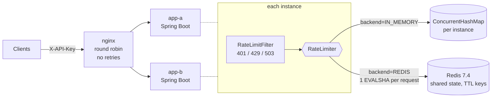

# RateGuard

A rate-limiting library and HTTP service: four classic algorithms behind one
interface, enforced by a Spring Boot filter with standard rate-limit headers.
A Redis backend enforces one shared quota across many instances.

> **Status (all 5 milestones complete):**
>
> - **Algorithms:** 4 in-memory and 2 Redis-backed (atomic Lua).
> - **Tests:** 128 automated tests run and pass, 0 skipped, including
>   Testcontainers tests against a real Redis.
> - **Correctness:** across **2 instances**, 1,000 concurrent requests from
>   one client with a quota of 100 gave exactly 100 accepted and 900
>   rejected in 6 of 6 k6 trials.
> - **Performance:** profiling a throughput plateau on the Redis path found
>   lock contention on the Lua script's SHA. Fixing it measured **+113%
>   to +117% throughput and −27% p99** in interleaved same-session
>   benchmarks.
>
> Numbers, method and limitations: [docs/BENCHMARKS.md](docs/BENCHMARKS.md)
> and [docs/EVIDENCE.md](docs/EVIDENCE.md). The measurements come from a
> 15 W laptop.

## Architecture



## Modules

| Module | Contents | Dependencies |
| --- | --- | --- |
| `rateguard-core` | Algorithms, `RateLimiter` interface, `RateLimitResult` | none (plain Java 25) |
| `rateguard-redis` | Redis fixed window and token bucket (Lua scripts) | core, Spring Data Redis (no Spring Boot) |
| `rateguard-service` | Spring Boot 4.1 HTTP service, filter, client identification, failure policy, metrics | core, redis, Spring Boot |

The core has no framework or network dependency, so it can be benchmarked
with JMH on its own. The Redis limiters can be benchmarked without starting
Spring Boot.

## Algorithms

| Algorithm | Class | Burst behaviour |
| --- | --- | --- |
| Fixed window | `FixedWindowRateLimiter` | up to 2× limit at a window boundary |
| Sliding-window log | `SlidingWindowLogRateLimiter` | none (exact) |
| Sliding-window counter | `SlidingWindowCounterRateLimiter` | smoothed approximation |
| Token bucket | `TokenBucketRateLimiter` | up to capacity, then refill rate |

All four run in memory. **Fixed window and token bucket also run on Redis**
(`RedisFixedWindowRateLimiter`, `RedisTokenBucketRateLimiter`). The sliding
windows are in-memory only, and choosing them together with `backend=REDIS`
stops the app at startup with a clear error.

Complexity, memory and trade-offs: [docs/ALGORITHMS.md](docs/ALGORITHMS.md).
Redis design (atomicity, keys, TTL, time source, failure modes):
[docs/DISTRIBUTED.md](docs/DISTRIBUTED.md).

## Running the service

Requires JDK 25 and Maven 3.9+.

```powershell
mvn -DskipTests package

# Authenticated mode (default): keys come from the environment, never from committed files
$env:RATEGUARD_API_KEYS = "demo-key-123,demo-key-456"
java -jar rateguard-service/target/rateguard-service-0.2.0-SNAPSHOT.jar

# Local demo mode: one quota per client IP, no key needed
java -jar rateguard-service/target/rateguard-service-0.2.0-SNAPSHOT.jar --spring.profiles.active=demo
```

```console
$ curl -i -H "X-API-Key: demo-key-123" http://localhost:8080/api/v1/demo/resource
HTTP/1.1 200
X-RateLimit-Limit: 5
X-RateLimit-Remaining: 4
{"resource":"demo","status":"ok"}

# ...sixth request within the window:
HTTP/1.1 429
X-RateLimit-Limit: 5
X-RateLimit-Remaining: 0
Retry-After: 6
{"status":429,"error":"rate_limit_exceeded","message":"...","retryAfterSeconds":6}
```

### HTTP behaviour

| Situation | Status | Headers |
| --- | --- | --- |
| Allowed | 200 (from the endpoint) | `X-RateLimit-Limit`, `X-RateLimit-Remaining` |
| Over the limit | 429 | the above, plus `Retry-After` (whole seconds, rounded up, never 0) |
| API-key mode, key missing or unknown | 401 | none; no quota is consumed and there is **no fallback to IP** |
| Redis unavailable, `FAIL_CLOSED` | 503 `rate_limiter_unavailable` | `Retry-After`; never reported as a 429 |
| Redis unavailable, `FAIL_OPEN` | request proceeds | no `X-RateLimit-*` headers, because no decision was made |
| Excluded path (`/actuator/**` by default) | unaffected | none |

`Retry-After` is the exact wait in milliseconds, rounded up to whole seconds
as RFC 9110 requires. Tests check that it is never early: at `Retry-After`
minus 1 ms the request is still rejected, and exactly at `Retry-After` it
succeeds.

## Configuration

All settings are under `rateguard.*` in
[application.yml](rateguard-service/src/main/resources/application.yml).
Invalid values stop the application at startup.

| Property | Default | Meaning |
| --- | --- | --- |
| `rateguard.enabled` | `true` | Master switch for the filter |
| `rateguard.backend` | `IN_MEMORY` | `IN_MEMORY` (per instance) or `REDIS` (shared by all instances) |
| `rateguard.algorithm` | `FIXED_WINDOW` | `FIXED_WINDOW`, `SLIDING_WINDOW_LOG`, `SLIDING_WINDOW_COUNTER`, `TOKEN_BUCKET` (Redis: first and last only) |
| `rateguard.limit` | `5` | Requests per window |
| `rateguard.window` | `60s` | Window length (`500ms`, `10s`, `1m`, ...) |
| `rateguard.token-bucket.capacity` | `limit` | Max burst (token bucket only) |
| `rateguard.token-bucket.refill-tokens` | `limit` | Tokens added per refill period, continuously |
| `rateguard.token-bucket.refill-period` | `window` | Refill period |
| `rateguard.protected-paths` | `/api/**` | Spring path patterns to limit |
| `rateguard.excluded-paths` | `/actuator/**` | Never limited; wins over `protected-paths` |
| `rateguard.eviction-interval` | `30s` | How often idle in-memory client records are removed |
| `rateguard.client-identification.mode` | `API_KEY` | `API_KEY` (authenticated) or `IP` (demos) |
| `rateguard.client-identification.api-key-header` | `X-API-Key` | Header carrying the key |
| `rateguard.client-identification.api-keys` | `${RATEGUARD_API_KEYS:}` | Comma-separated valid keys; `API_KEY` mode refuses to start without any |
| `rateguard.redis.key-prefix` | `rateguard` | Namespace for all Redis keys |
| `rateguard.redis.failure-mode` | `FAIL_CLOSED` | `FAIL_CLOSED` (503 while Redis is down) or `FAIL_OPEN` (requests pass, unlimited) |
| `rateguard.redis.unavailable-retry-after` | `5s` | `Retry-After` sent with the 503 |
| `rateguard.redis.time-source` | `REDIS_SERVER` | `REDIS_SERVER` (Redis `TIME`, the same clock for all instances) or `APPLICATION` (tests) |
| `rateguard.instance-id` | empty | If set, echoed as `X-RateGuard-Instance` (demo only) |
| `spring.data.redis.host` / `port` | `${REDIS_HOST:localhost}` / `${REDIS_PORT:6379}` | Redis location |
| `spring.data.redis.timeout` / `connect-timeout` | `500ms` / `500ms` | Upper bound on how long a request waits for Redis before the failure mode applies |

Behind a reverse proxy in `IP` mode, set `server.forward-headers-strategy=native`
so the container takes the client IP from trusted proxies. The service never
parses `X-Forwarded-For` itself, because clients can forge it.

### Observability

| Endpoint / metric | Purpose |
| --- | --- |
| `/actuator/health`, `/health/liveness`, `/health/readiness` | Probes, never rate limited |
| `rateguard.requests{algorithm, outcome}` | Counter. `outcome` is `allowed`, `rejected`, `unauthenticated`, `fail_open` or `fail_closed` |
| `rateguard.decision{algorithm}` | Timer around `RateLimiter.tryAcquire` |
| `rateguard.clients.tracked` | Gauge of in-memory client records |
| `rateguard.backend.available` | 1 if the last decision reached the backend, otherwise 0 |

Metric tags are deliberately low-cardinality: client identifiers and API keys
never appear in tags or logs. Only SHA-256 digests of keys are held in memory.

## Distributed deployment (Docker Compose)

Redis, two app instances (`app-a`, `app-b`) and an nginx round-robin load
balancer. Only nginx publishes a port. Redis and the apps sit on an internal
network. API keys come from your shell or a git-ignored `.env` file and are
never committed.

```powershell
mvn -DskipTests package                    # builds the jar the image uses
copy .env.example .env                     # then put your own random keys in .env
docker compose up --build -d               # waits for Redis and both apps to be healthy
docker compose ps

./scripts/verify-shared-quota.ps1 -Requests 12
# Verified 2026-11-26: 5 x 200 then 7 x 429, alternating app-a/app-b (6/6),
# Remaining 4->0 across both instances, all inside one window (Redis clock).
# With backend=IN_MEMORY the same run would allow up to 10.

docker compose logs app-a app-b            # look for "RateGuard: backend=REDIS ..."
docker compose stop redis                  # simulate an outage: 503 (FAIL_CLOSED) or 200 (FAIL_OPEN)
docker compose start redis                 # recovery: normal 200/429 again

docker compose down                        # stop and remove everything
```

Settings such as `RATEGUARD_ALGORITHM=TOKEN_BUCKET`, `RATEGUARD_LIMIT`,
`RATEGUARD_WINDOW` and `RATEGUARD_REDIS_FAILUREMODE` can be set in `.env`.

## Design decisions

- **Rich result, not a boolean.** `RateLimitResult(allowed, limit, remaining,
  retryAfter)` maps directly onto the HTTP headers.
- **One swap point for backends.** The filter depends only on the
  `RateLimiter` interface. `RateLimiterFactory` and the `rateLimiter` bean
  are the only places that pick an implementation, so a Redis-backed limiter
  replaces one bean.
- **Per-key serialization via `ConcurrentHashMap.compute`,** with the clock
  read inside the critical section. See [docs/ALGORITHMS.md](docs/ALGORITHMS.md).
- **Fail closed on identity.** API-key mode never falls back to IP, so a
  missing header can't be used to borrow someone else's (or no) quota.
- **Eviction is decision-neutral.** Only state identical to a fresh client is
  removed. Tests check this at the library level (every request) and over
  HTTP.
- **Injectable `java.time.Clock` everywhere,** so time-dependent HTTP tests
  are deterministic and run in milliseconds.
- **One atomic Lua script per request on Redis.** The read, check, update and
  TTL happen in one step, using Redis server time by default, so instances
  never race and app-server clock skew doesn't matter.
- **Infrastructure failure is not a rate-limit violation.** Redis outages
  produce 503 (`FAIL_CLOSED`) or pass-through (`FAIL_OPEN`), never a 429, and
  they don't make health probes fail.

## Tests

```powershell
mvn clean test
```

| Module | Tests | Highlights |
| --- | --- | --- |
| core | 68 | contract tests across all 4 algorithms, exact `retryAfter`, 16-thread exact-limit test, linearizability replay (8 threads × 2,000 requests) |
| redis | 13 (Docker) | same decisions as in-memory on 3,000 random requests; 1,000 concurrent → exactly 100; server-clock expiry and refill; TTL; key hashing; backwards clock; unreachable Redis |
| service | 34 + 13 (Docker) | MockMvc and real Tomcat (see above); failure policy; backend selection. With Docker: 2 real instances on one Redis, 1,000 concurrent HTTP requests → exactly 100 × 200 and 900 × 429; Redis down, paused or connections killed |

Tests marked "(Docker)" use Testcontainers and are **skipped automatically**
when Docker isn't running.

## Roadmap

| Milestone | Scope | Status |
| --- | --- | --- |
| 1. Foundation | Git setup, fixed-window limiter | done |
| 2. Core algorithms | 4 algorithms, `RateLimitResult`, contract tests | done |
| 3. HTTP service | Spring Boot filter, 429 + headers, API-key/IP identification, eviction, metrics | done |
| 4. Distributed | Redis + Lua backends, failure modes, Docker Compose with 2 app instances, shared quota | done, verified with Docker ([EVIDENCE](docs/EVIDENCE.md)) |
| 5. Performance | JMH, k6 (4 scenarios × 3 load levels × 3 trials), correctness under load, heap per client, Redis-path fix | done ([BENCHMARKS](docs/BENCHMARKS.md)) |

## Benchmarks

Measured on a 15 W laptop (i5-1335U), with the app capped at 2 CPUs per
container. Full tables, raw files and limitations are in
[docs/BENCHMARKS.md](docs/BENCHMARKS.md).

| Measurement | Result |
| --- | --- |
| HTTP, no limiter vs in-memory limiter (k6, 50 VUs) | 6,544 vs 6,468 req/s: the difference is within run-to-run noise |
| HTTP, Redis limiter, 1 instance (k6, 50 VUs), after the fix | 2,488 req/s, p99 79 ms |
| Redis-path fix (interleaved before/after, same session) | **+113% to +117% req/s, −27% p99, −74% p50** |
| Quota under load: 2 instances, 1 client, 1,000 requests, quota 100 | exactly 100 accepted / 900 rejected, 6 of 6 trials |
| In-memory decision (JMH, 1 thread) | about 26M decisions/s |
| Heap per client | 77 B (fixed window) to 1,125 B (sliding-window log at 100 stored requests) |

Reproduce:

```powershell
mvn -DskipTests package; docker compose build
./benchmarks/jmh/run-jmh.ps1           # JMH sweep and heap measurement (about 20 min)
./benchmarks/k6/run-k6.ps1             # k6 scenarios A-D and correctness (about 40 min)
python benchmarks/summarize.py         # regenerates benchmarks/results/SUMMARY.md
```
